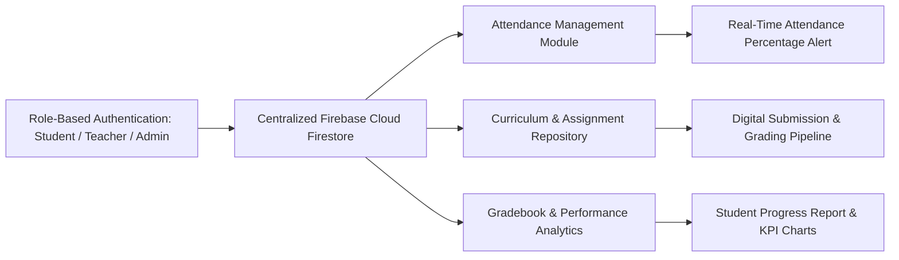

<div align="center">

  <!-- NATIVE ANIMATED CYBER BANNER -->
  

  <br/>

  <!-- ANIMATED TYPING SVG -->
  

  <br/>

  <!-- TECH BADGES -->
  <p align="center">
    
    
    
    
    
  </p>

</div>

---

### 🌟 System Overview

**Smart Education System** is a unified digital ecosystem connecting students, educators, and administrators. Built with Flutter and Firebase, it modernizes academic workflows—providing automated attendance logging, digital grading ledgers, assignment repositories, and transparent real-time parent notifications.

---

### 🔬 Operational Architecture & Data Pipeline Flow



---

### 🚀 Key Capabilities & Features

- **📱 Cross-Platform Accessibility:** Seamless experience across Android, iOS, and Web with native Flutter performance.
- **📊 Visual Performance Analytics:** Interactive score graphs, attendance percentage alerts, and academic trend charts.
- **🔐 Role-Based Access Control:** Granular permissions ensuring private academic records and secure administrative control.
- **📁 Cloud Assignment Submissions:** Paperless distribution, student submission tracking, and timestamp verification.

---

### ⚡ Quickstart & Execution

```bash
# 1. Clone & enter
git clone https://github.com/Akshay-Notfound/Smart-Education-System.git
cd Smart-Education-System

# 2. Get dependencies
flutter pub get

# 3. Launch application
flutter run
```

---

### 👤 Author & Architecture

**Akshay Shivaji Rathod**  
*Data & AI Engineer*  
* 🌐 **Portfolio:** [akshay-notfound.vercel.app](https://akshay-notfound.vercel.app)  
* 💼 **LinkedIn:** [linkedin.com/in/akshay-rathod-aaab52206](https://www.linkedin.com/in/akshay-rathod-aaab52206/)  
* 🐙 **GitHub:** [@Akshay-Notfound](https://github.com/Akshay-Notfound)  

---

<div align="center">
  <sub>Licensed under the MIT License. Designed for scalability, intelligence, and performance.</sub>
</div>
